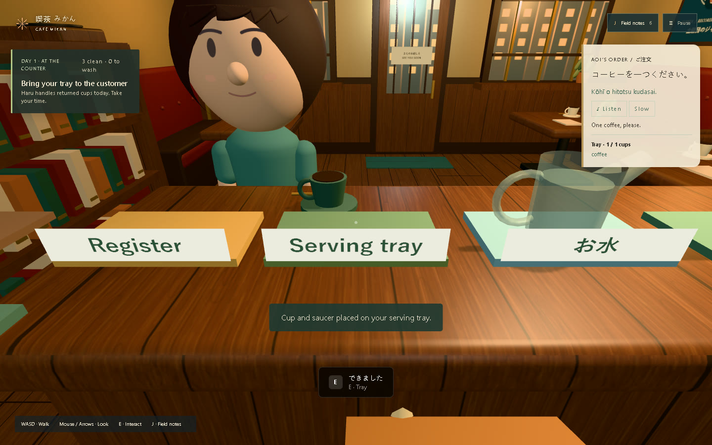

# Mikanra

**Learn practical Japanese through seven mornings running a neighborhood cafe.**

Mikanra is a desktop browser game about preparing drinks, understanding your customers, and becoming part of their neighborhood. At Cafe Mikan, greetings and orders matter because they help you do something for someone you get to know.



[Play the current release](https://flaune.github.io/mikanra-game/) · [Original Bolt deployment](https://mikanra-japanese-lea-d6bu.bolt.host/) · [Submission pack](docs/submission/README.md) · [Business assessment](docs/BUSINESS.md)

The current game is published on GitHub Pages as a free prototype backup. The original Bolt deployment was found to serve an earlier prototype and still needs synchronization through the founder's signed-in Bolt project. Check [release status](docs/submission/RELEASE_STATUS.md) before choosing the contest live link.

## What you can play

- Seven connected cafe mornings with Haru, Aoi, Ren and Yui, ending at a neighborhood reading evening.
- Physical coffee, tea and water preparation; reusable cups, washing, stock replenishment and checkout.
- Japanese greetings, orders, quantities, prices and preparation vocabulary, with 50 bundled pronunciation clips.
- English meanings and romaji that fade as supported and independent learning evidence grows; help remains available.
- Persistent relationships, notebook practice, an optional comprehension check and continued cafe free play after the ending.

This is a small beginner learning experience. It is not a complete course, a fluency assessment, or a proven learning intervention. No live AI, account, paid subscription, API key, or database is required to play.

## Run locally

Use **Node.js 24** and npm. From this repository root:

```sh
npm ci
npm run dev
```

Open the Vite URL in a current desktop browser with WebGL, a keyboard and mouse. Chromium is the primary automated test target. Touch-only devices and viewports narrower than 701 pixels display a desktop notice instead of starting the game. Controller and touch gameplay are not implemented.

```sh
npm run check                 # Types, lint, 72 unit/runtime tests, production build
npm run preview               # Serve the production build locally
npx playwright install chromium
npm run test:e2e              # Starts its own dev and preview servers; runs browser checks
npm audit --audit-level=high
```

On Linux CI, install Chromium dependencies with `npx playwright install --with-deps chromium`. An existing Chromium executable can be selected through `PLAYWRIGHT_CHROMIUM_EXECUTABLE_PATH`. The end-to-end runner uses local ports 4175 and 4176 and writes evidence to ignored `output/playwright/`. It never uses your normal browser profile.

Production output is `dist/`. Run `npm run build -- --base=/your-subpath/` for subdirectory hosting. Audio, Rive artwork, WASM and license notices are bundled under `public/`. The Rive WASM is synchronized with the installed runtime before every build. The large 3D/physics bundle produces a size warning; hardware performance has not been benchmarked across devices.

## Controls

| Action | Control |
| --- | --- |
| Walk / look | WASD / mouse or arrow keys |
| Interact | E |
| Pour, wash, wipe | Hold E; early release retains manual progress |
| Tea batch size | 1 or 2 before measuring leaves |
| Preparation meaning / pronunciation | H / L |
| Field notes | J |
| Pause, dismiss, skip arrival | Escape |

The game supports pointer-lock fallback. Notebook settings include Japanese help, romaji, camera motion and picture quality. See [cafe controls](docs/CONTROLS.md) and [Chapter One](docs/CHAPTER_ONE.md) for the full loop.

## Saves and privacy

Progress lives in this browser's `localStorage`, under `mikanra.chapter-one.v1` and `mikanra.learning.v1`. It does not sync across devices or between different website origins. Clearing site storage removes it. Corrupt saves recover safely; blocked storage permits session-only play. Timers freeze during menus, pause and hidden tabs, with no offline catch-up.

The app has no analytics, payment processing, microphone recording or account system. Hosting providers receive normal web requests; fonts are requested from Google Fonts. Bundled phrases play locally after download; a Japanese system voice can serve as a fallback. No learning progress is sent to a developer-operated server.

## Development and provenance

React owns the HTML overlays; Three.js owns the procedural scene; Rapier handles collision; serializable modules manage cafe and learning state. Rive provides cosmetic preparation feedback and a static fallback. See [architecture](docs/ARCHITECTURE.md), [audio regeneration](public/audio/README.md), and [Rive authoring](rive/README.md).

Bryan conceived and directed the game. Bolt.new created the initial playable foundation; substantial subsequent core development and testing used OpenAI Codex. Rive CLI authored the preparation feedback. These roles are disclosed in the submission pack. Historical reviews are archived under `docs/history/` and do not describe the current release's support guarantees.

## Commercial rights

© 2026 Bryan. **All rights reserved** for original code, artwork and game content. Public source availability does not grant an open-source license. Third-party software, fonts and voice material retain their own licenses. See [LICENSE](LICENSE) and [asset notices](THIRD_PARTY_NOTICES.md). Contact Bryan through [bhach.com](https://www.bhach.com) for reuse or partnership permission.
